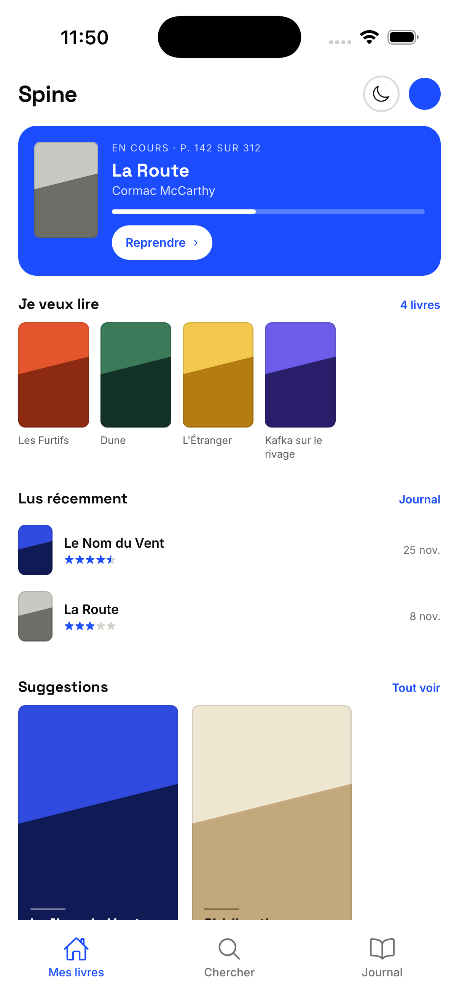
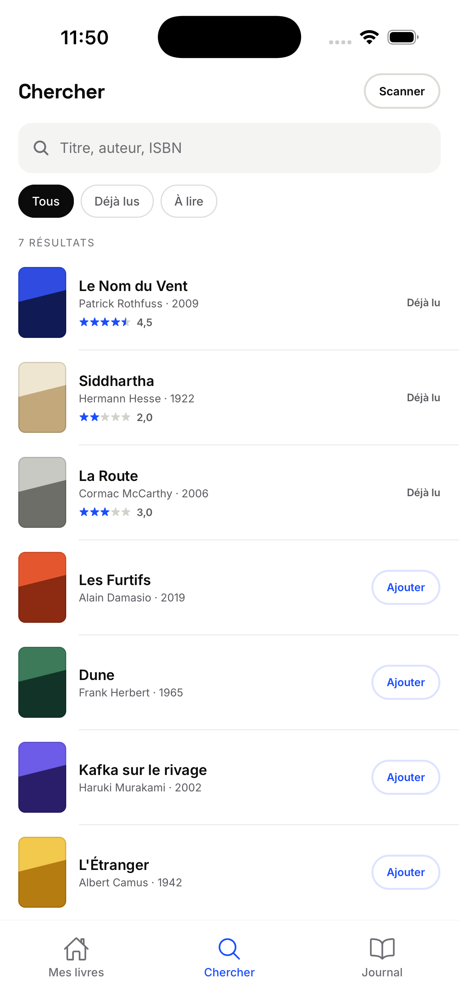
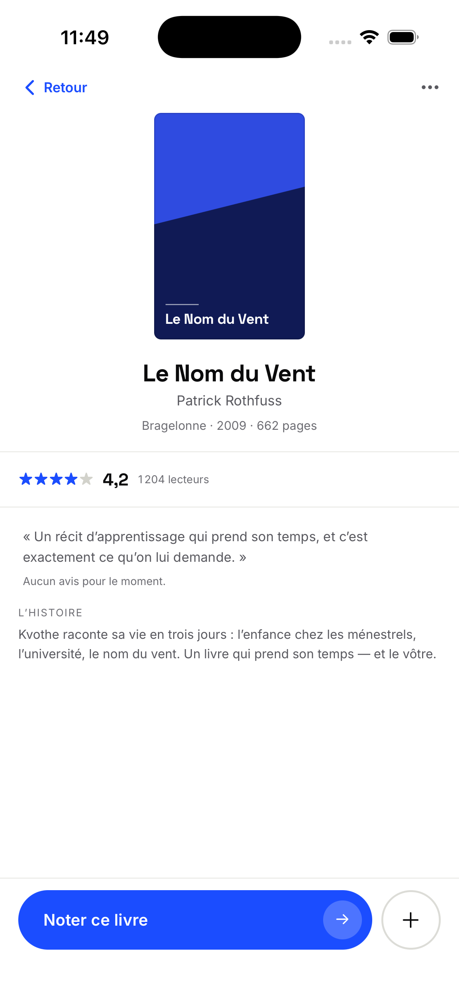
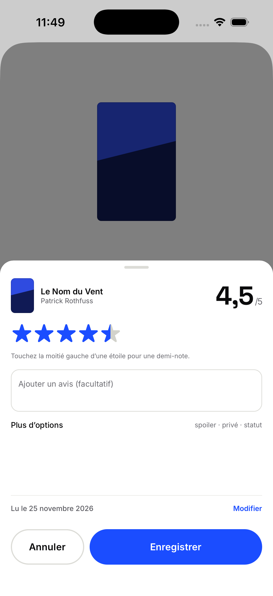
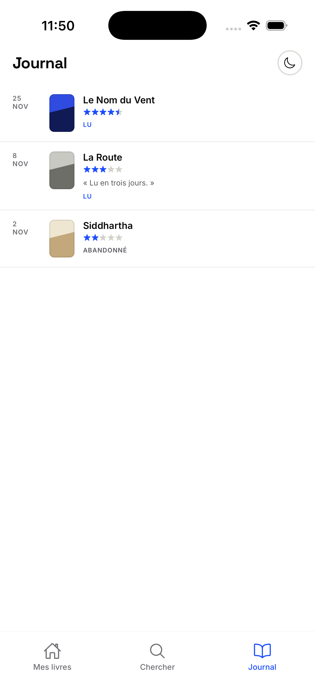

# Spine — refaire les deux gestes que Goodreads rate

> Étude de cas · refonte de la notation et de la découverte de livres
> React Native / Expo · TypeScript · iOS + Android · 2026

Goodreads remplit sa fonction : un catalogue, des étagères, des avis. Mais deux gestes
quotidiens y coûtent trop cher — **noter un livre** et **retrouver un livre** — et l'app n'a
aucune trace datée de ce qu'on a lu. Spine reprend ces deux parcours de zéro, en gardant de
Letterboxd la mécanique (demi-étoiles, journal daté) et rien de son habillage.

---

## 1. Le constat

| Problème Goodreads | Ce que ça produit |
|---|---|
| Noter demande 3 écrans : fiche → « Write a review » → formulaire web → 5 étoiles entières | On ne note pas « en passant ». La note arrive des jours plus tard, ou jamais. |
| La recherche rend une liste de texte, où le livre et ses éditions se mélangent | On cherche un livre qu'on a vu en librairie et on tombe sur l'édition allemande de 1994. |
| Aucune trace datée : une note écrase la précédente | Impossible de dire « j'ai lu ça en novembre », de relire un livre et de garder les deux notes. |
| L'interface date : beige, petites graisses, fiches encombrées | L'information utile est noyée dans les métadonnées. |

Trois directions artistiques ont été produites puis **rejetées** (« ça ne change pas assez de
Goodreads », « les tranches ne sont pas instinctives ») avant d'arriver à celle-ci. Ce document
montre le résultat final ; `ITERATIONS.md` garde la trace des impasses.

---

## 2. La réponse, écran par écran

### 2.1 Mes livres — « qu'est-ce que je lis, qu'est-ce que je veux lire »

| Problème | Décision | Effet |
|---|---|---|
| Chez Goodreads, l'accueil est un flux d'actualités de ses amis ; ce qu'on lit soi-même est relégué. | L'écran s'ouvre sur **une carte « En cours »**, seul aplat de couleur de l'app (cobalt), avec la progression et un bouton « Reprendre ». | L'action la plus fréquente est la première chose qu'on voit, à portée de pouce. |
| Les envies et les lectures sont dans le même sac d'« étagères ». | Deux blocs distincts : **Je veux lire**, puis **Lus récemment** avec la note et la date. | Les trois états d'un livre (en cours / envie / lu) sont séparés visuellement, sans explication. |
| Découvrir demande d'aller dans un onglet séparé. | Les suggestions vivent en bas, avec leur motif écrit en clair (« Parce que vous avez aimé Dune »). | La découverte ne prend jamais le pas sur la bibliothèque personnelle. |

### 2.2 Chercher — « retrouver un livre précis »

| Problème | Décision | Effet |
|---|---|---|
| Résultats en liste dense où titre, auteur, année et note se confondent. | Ligne unique : couverture, titre, auteur · année, note si on l'a déjà lu, et **un seul bouton** « Ajouter ». | On sait en un regard si le livre est déjà dans sa bibliothèque. |
| Aucun filtre rapide, il faut ouvrir un panneau. | Trois pastilles : Tous / Déjà lus / À lire. | Filtrer coûte un tap, pas un écran. |
| La couverture est une vignette de 40 px. | La couverture est le premier élément de la ligne, à gauche, à hauteur de lecture. | C'est ce qu'on reconnaît d'un livre, pas son ISBN. |

### 2.3 Fiche — « décider »

| Problème | Décision | Effet |
|---|---|---|
| Fiche encombrée : séries, éditions, formats, bibliothèques, amis… | Quatre lignes d'information (éditeur · année · pages), une note communautaire, un extrait d'avis, un résumé. | On décide avec ce qu'on a sous les yeux, sans scroller. |
| L'action principale est un lien texte perdu au milieu. | Un bouton capsule pleine largeur, en bas, dans la zone du pouce. | « Noter ce livre » ne se cherche pas. |
| Ajouter à sa bibliothèque est une autre page. | Un bouton rond « + » à côté du bouton principal. | Deux intentions, deux boutons, aucun menu. |

### 2.4 Notation — « le geste »

| Problème | Décision | Effet |
|---|---|---|
| 5 étoiles entières, dans un formulaire, séparé de la fiche. | Une **feuille modale** par-dessus la fiche : 5 étoiles de 32 pt, le chiffre en 38 pt, deux gestes. | Le livre reste visible pendant qu'on le note. |
| Impossible de mettre 4,5. | La moitié gauche d'une étoile donne la demi-note, et le chiffre géant lève l'ambiguïté. | La précision sans explication : on lit « 4,5 / 5 » en gros. |
| Un avis obligatoire, un formulaire, des cases. | L'avis est un champ facultatif ; spoiler, privé, statut et date sont repliés sous « Plus d'options ». | Le parcours par défaut tient en un geste et demi. |

### 2.5 Journal — « la trace »

| Problème | Décision | Effet |
|---|---|---|
| La note remplace la précédente, sans date. | Chaque note crée **une entrée datée** (jour + mois), avec la note, l'avis et le statut. | Relire un livre crée une deuxième entrée au lieu d'écraser la première. |
| Aucun état hors ligne : on perd sa note en cas de réseau absent. | Bandeau « Une note attend le réseau », et un statut par entrée. | On note dans le métro, la note part plus tard. |
| Le thème est imposé. | Bascule clair/sombre en icône, sur l'accueil et dans le Journal. | Un seul bouton, deux thèmes, mêmes contrastes. |

---

## 3. Le design system

| Élément | Choix | Pourquoi |
|---|---|---|
| Accent | Cobalt `#1B4DFF` | 5,91:1 sur blanc — un seul accent, donc zéro ambiguïté sur ce qui est actionnable. |
| Typographie | Space Grotesk 700 (titres) · Inter 400–600 (interface) | Titres à 22 pt : lisible d'un coup d'œil, là où Goodreads reste en petites graisses. |
| Formes | Boutons capsule 52 pt, rayons 12 pt, **aucune ombre** | Hiérarchie par la couleur et l'espace, pas par des effets. |
| Thème sombre | Encre 16,8:1 · accent 7,0:1 · texte sur accent 7,3:1 | Les jetons basculent, la structure ne change pas. |
| Accessibilité | Cibles ≥ 44 pt, libellés VoiceOver sur chaque bouton, étoiles exposées en `adjustable` | La demi-étoile reste utilisable au lecteur d'écran. |

Contrastes calculés par script (`lab/contrast.py`), jamais à l'œil : les modèles se trompent
systématiquement sur ce calcul (voir §4).

---

## 4. Le process, et ce qu'il a coûté

Le projet a été mené avec une **équipe d'agents** (PM → PO → Tech Lead ‖ 3 designers → critique),
chacun avec un modèle choisi selon le coût de son erreur : petit modèle pour cadrer, modèle « goût »
pour le design, modèle différent du producteur pour la critique (pour éviter l'auto-complaisance).

| Itération | Contenu | Appels | Coût réel |
|---|---|---|---|
| 0 | Cadrage, 6 stories, plan technique Expo, 3 directions artistiques, critique | 7 | **0,0892 $** |
| 0 bis | Consolidation de la direction retenue (fusion + corrections) | 1 | **0,0243 $** |
| 1–3 | Deux directions rejetées (tranches, affiche), puis la direction « Clair » | 0 | 0 $ |
| 4 | Code : 15 fichiers, 1 386 lignes, 5 écrans, 2 thèmes | 0 | 0 $ |
| **Total API** | | **8** | **0,1135 $** |

Trois enseignements que ce projet a réellement produits :

1. **Le coût est dans les décisions, pas dans les tokens.** 11 centimes pour la conception,
   zéro pour le code — mais trois allers-retours de design, parce que le brief initial
   (« moderne, inspiré de Letterboxd ») ne disait ni le niveau de familiarité attendu ni le niveau
   de rupture. Un brief qui ne dit pas ce qu'il **interdit** produit de la moyenne.
2. **Un modèle ne mesure pas.** Les agents annonçaient des contrastes 4,8:1 qui mesuraient 3,45:1.
   Le calcul WCAG est passé dans un script, et la critique humaine est devenue la seule juge
   du *goût* — pas de la mesure.
3. **La critique vaut mieux que la génération.** Le même pipeline qui produit trois directions
   médiocres produit une critique utile : « cet écran coûte un geste de trop », « ce token manque ».

---

## 5. Ce qui est livré, ce qui ne l'est pas

**Livré et vérifié**
- App Expo SDK 58 / RN 0.88, TypeScript strict, 5 écrans, thèmes clair et sombre.
- Notation fonctionnelle de bout en bout : étoiles → entrée datée dans le Journal.
- `tsc --noEmit` et `eslint` à 0 erreur ; build iOS réussi ; captures prises sur simulateur.

**Volontairement absent (sprint 2)**
- Les livres sont des données de démonstration (7 entrées) : pas d'API Open Library / Google Books.
- Pas de persistance : les notes vivent en mémoire et disparaissent au redémarrage.
- Pas de scan ISBN, pas de tests automatisés.

---

## 6. En une phrase

Spine ne réinvente pas la lecture : il remet la note et la recherche au niveau du geste qu'elles
demandent — un pouce, deux taps, une trace datée — et laisse la décoration aux autres.
